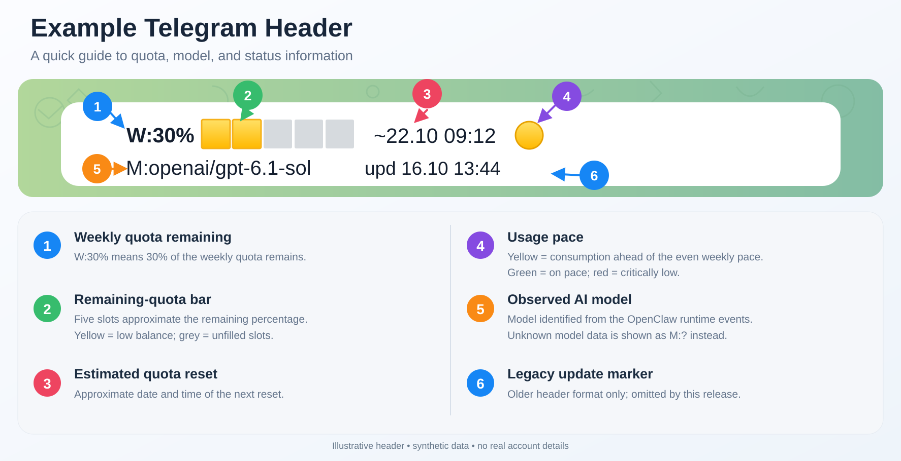
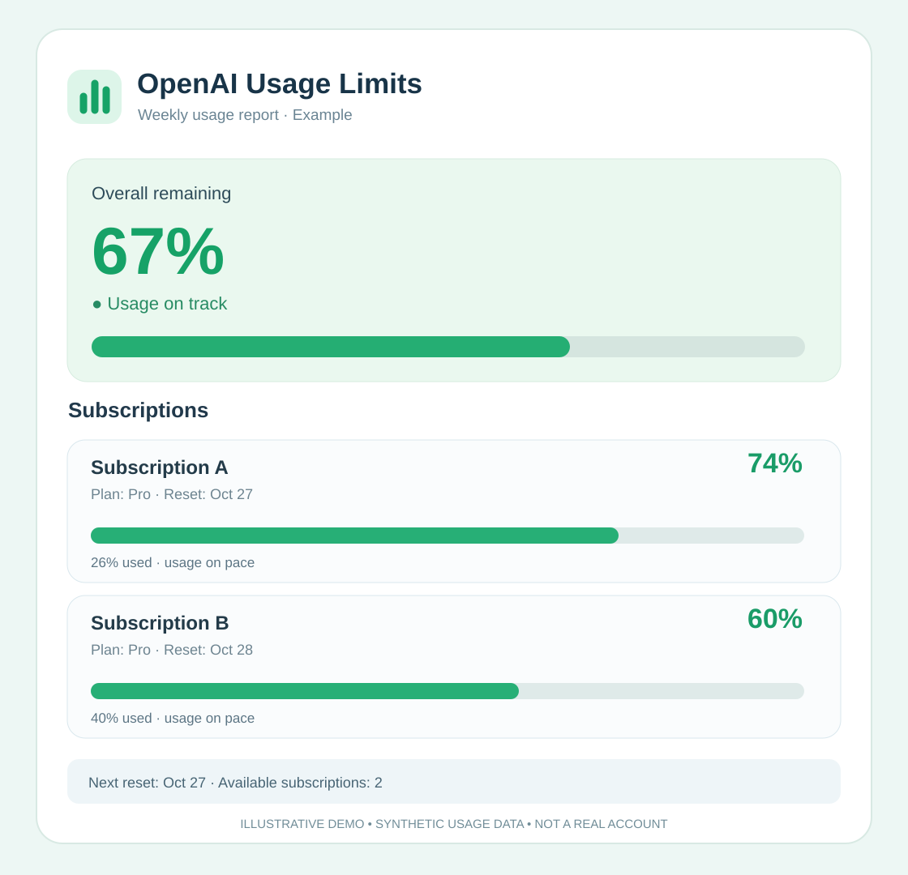

# OpenClaw Telegram Response Header

**Know your limits.** Show OpenAI quota, the observed AI model, and a private `/limits` report directly in OpenClaw Telegram replies.

[](https://github.com/igorrusakovich01-stack/openclaw-telegram-response-header/actions/workflows/ci.yml)


## Previews

**Telegram response header**



> Annotated example with synthetic data. The `upd` field belongs to a legacy header format and is **not emitted by the current public release**.

**Private `/limits` report**



> These are **illustrative demo previews made with synthetic usage data**. They are not captures of real user accounts or chats. Actual PNG reports are generated locally from the OpenClaw usage cache.

## Features

- **W:** cached OpenAI weekly quota remaining, five-segment progress bar, next reset, and pace indicator.
- **M:** observed model identifier, including model changes when the correlated runtime events are available. Unknown model data is displayed as `M:?`, never invented.
- **`/limits`:** owner-only private Telegram command for a per-subscription PNG usage report, with text fallback. It does not invoke an LLM.
- **Multiple OpenAI OAuth profiles:** reads available profiles and shows each subscription; combines percentages only when provider plan information is comparable.
- **Background updates:** Linux systemd user timer refreshes the local cache approximately every five minutes; cache is valid for up to ten minutes.
- **No alerts or unsolicited notifications.** The plugin adds information to existing bot responses.

### Response format

```text
W:**67%** 🟩🟩🟩⬜⬜ ~27.10 18:00 🟢
M:**openai/gpt-6.1-sol**

Your bot's normal response...
```

The example figures above are synthetic.

## Requirements

- A working OpenClaw Gateway with Telegram enabled.
- **OpenClaw 2026.10.4 or newer**, subject to the compatibility limitations below.
- Linux with a user-level **systemd** instance for the installer and cache timer.
- Python 3, Node.js and the OpenClaw CLI accessible to the user running the Gateway.
- Pillow and a TrueType font for PNG reports (for Debian/Ubuntu: `sudo apt install python3-pil fonts-dejavu-core`).
- An authorized OpenAI OAuth profile; `codex.accountUsage` must be available to display a verified quota.

The plugin does not create or store OAuth tokens. Other LLM providers may appear as the observed **M** model, but **W** measures only supported OpenAI subscriptions.

## Install

On the same Linux account that runs your OpenClaw Gateway:

```bash
git clone https://github.com/igorrusakovich01-stack/openclaw-telegram-response-header.git
cd openclaw-telegram-response-header
bash ./install.sh --agent main --timezone UTC
```

Change `main` to your quota-bearing agent and `UTC` to your IANA time zone. The installer copies the plugin and helper scripts, enables the systemd user timer, and refreshes the quota cache. It **does not automatically restart** the Gateway or overwrite OAuth credentials. It keeps a backup of an existing installed plugin directory.

Then set the private `/limits` owner (replace the example numeric ID):

```bash
openclaw config set plugins.entries.telegram-response-header.config.ownerTelegramId '"123456789"' --strict-json
```

For reliable observed model labels on native Telegram delivery routes, you may grant this plugin access to LLM lifecycle hooks:

```bash
openclaw config set plugins.entries.telegram-response-header.hooks.allowConversationAccess true --strict-json
```

**Security note:** enabling `allowConversationAccess` grants the plugin the ability to receive conversation-bearing lifecycle events. This implementation uses only session and model metadata, but you should review the source before granting that permission. Without it, the fallback path may display `M:?`.

Optional settings:

```bash
openclaw config set plugins.entries.telegram-response-header.config.reportTitle '"OpenAI Usage Limits"' --strict-json
openclaw config set plugins.entries.telegram-response-header.config.timeZone '"UTC"' --strict-json
```

Apply the configuration and verify:

```bash
openclaw plugins reload telegram-response-header
openclaw gateway status --deep
systemctl --user status codex-usage-cache.timer --no-pager
```

If `reload` fails due to a stale or invalid plugin configuration, **do not run a repair command blindly**. Check `openclaw plugins doctor`, examine the exact error, and follow the version-specific instructions.

Send your Telegram bot an ordinary message to see the W/M header. Use `/limits` in the owner's private chat to request a PNG report.

See [Configuration](docs/configuration.md) and [Security and privacy](SECURITY.md).

## How it works

1. `tools/codex-usage-header` discovers the selected agent's OpenAI OAuth profile identifiers.
2. It requests each profile's `codex.accountUsage` data through the local Gateway.
3. `tools/codex-usage-cache-update` atomically writes the usage JSON cache with restricted filesystem permissions.
4. A systemd user timer refreshes the cache every five minutes.
5. The plugin prepends the cached W line to eligible Telegram replies and correlates M with available model lifecycle events.
6. The owner-only `/limits` command renders a fresh PNG locally using Python/Pillow, or returns text if image delivery fails.

No external metrics server, third-party telemetry, or LLM call is required for generating the usage header and `/limits` image.

## Compatibility and future OpenClaw releases

The underlying behavior was verified on **OpenClaw 2026.10.4** with the original private deployment. This public English-only distribution has separate source/renderer checks, but it is **not a guarantee of end-to-end compatibility with every later version**.

We intend to support future stable OpenClaw releases **on a best-effort basis**. A scheduled GitHub Actions job probes the latest published OpenClaw installation and plugin inspection; failures indicate a need for investigation, not automatic repairs or guaranteed compatibility.

- Supported install target: Linux/systemd user service.
- macOS and Windows installer support: not yet implemented or tested.
- Model events and Telegram send paths can change between OpenClaw versions.
- If the source cannot verify quota or model, the plugin displays an unknown value rather than fabricating data.

See [Compatibility](docs/compatibility.md) for limitations.

## Development

```bash
bash scripts/check.sh
```

The checks validate script syntax, plugin hook contracts, an English-only source tree and a synthetic-data PNG smoke test. The CI workflow also attempts to load the plugin against the latest OpenClaw version.

Contributions are welcome: [Contribution guide](CONTRIBUTING.md). For sensitive issues, see [Security reporting](SECURITY.md).

## Uninstall

```bash
bash ./uninstall.sh
```

The script disables the plugin and removes its managed systemd user timer/service. It intentionally keeps credentials, OAuth profiles, cache, and workspace files.

## License

[MIT](LICENSE).
